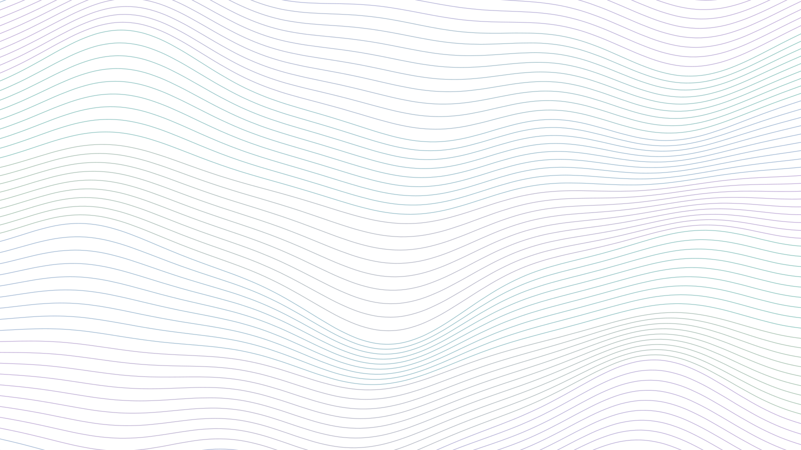
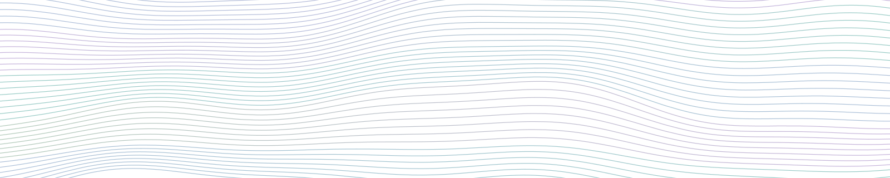

<!--
  BRAND GUIDE: a living reference.
  Source of truth for colors and fonts: _brand.yml
  Component styles: styles.scss · Wave artwork: scripts/make_waves.py
  If you change a color in _brand.yml, update the swatch hex below too.
-->

```{=html}
<style>
  .bg-sec { margin: 3rem 0 1rem; }
  .sw-grid { display:grid; grid-template-columns:repeat(auto-fill,minmax(170px,1fr)); gap:1rem; }
  .sw { border-radius:1.1rem; overflow:hidden; background:#fff; border:1px solid var(--jc-line); box-shadow:var(--jc-shadow); }
  .sw .chip { height:110px; }
  .sw .info { padding:.75rem .9rem .9rem; }
  .sw .nm { font-family:var(--jc-serif); font-size:1.05rem; color:var(--jc-ink); }
  .sw .hx { font-family:var(--jc-mono); font-size:.78rem; color:var(--jc-plum); }
  .sw .use { font-size:.8rem; color:var(--jc-muted); margin-top:.25rem; line-height:1.4; }
  .ploen-bar { display:flex; height:84px; border-radius:1.1rem; overflow:hidden; box-shadow:var(--jc-shadow); margin:1rem 0 .4rem; }
  .ploen-bar div { flex:1; }
  .grad { height:96px; border-radius:1.1rem; box-shadow:var(--jc-shadow); display:flex; align-items:flex-end; padding:.7rem 1rem; font-family:var(--jc-mono); font-size:.75rem; color:var(--jc-ink); }
  .type-row { display:grid; grid-template-columns:180px 1fr; gap:1.5rem; padding:1.2rem 0; border-top:1px solid var(--jc-line); align-items:baseline; }
  .type-row .lbl { font-family:var(--jc-mono); font-size:.75rem; color:var(--jc-plum); }
  .do-dont { display:grid; grid-template-columns:1fr 1fr; gap:1.25rem; }
  .do-dont > div { border-radius:1.1rem; padding:1.2rem 1.4rem; background:#fff; border:1px solid var(--jc-line); }
  .do-dont h4 { font-family:var(--jc-sans); font-size:.75rem; letter-spacing:.14em; text-transform:uppercase; margin:0 0 .6rem; }
  .do-dont .do h4 { color:var(--jc-eucalyptus); } .do-dont .dont h4 { color:var(--jc-rose); }
  .do-dont ul { padding-left:1.1rem; margin:0; font-size:.93rem; }
  .art { border-radius:1.25rem; overflow:hidden; box-shadow:var(--jc-shadow); }
  .art img { width:100%; display:block; }
  @media (max-width:800px){ .type-row{grid-template-columns:1fr; gap:.3rem} .do-dont{grid-template-columns:1fr} }
</style>

<div class="wrap" style="padding:0">

<!-- ESSENCE -->
<div class="about-grid">
  <div>
    <div class="eyebrow">Essence</div>
    <h2 class="section-title">Soft landscapes, sharp science</h2>
    <p class="lead-text">The brand pairs the rigor of a research lab with the calm of a landscape at dusk. Think
    topographic contour lines, water meeting desert, and Dune-cover lavender skies. It should feel
    <strong>modern, quiet, and trustworthy</strong>: never loud or gimmicky.</p>
    <p>Four words guide every choice: <strong>clear · calm · grounded · curious.</strong></p>
  </div>
  <dl class="facts">
    <dt>Personality</dt><dd>A field scientist who also writes clean code</dd>
    <dt>Inspiration</dt><dd>ltc "ploen" palette · <em>The Carbon Wave</em> cover · Dune covers · contour maps</dd>
    <dt>Signature</dt><dd>Flowing contour waves, glassy cards, serif headlines</dd>
  </dl>
</div>

<!-- PALETTE -->
<section class="bg-sec">
  <div class="eyebrow">Color</div>
  <h2 class="section-title">The ploen core</h2>
  <p class="muted">Five colors from the <code>ltc</code> "ploen" palette carry the brand. Slate does the heavy
  lifting; the rest are accents.</p>
  <div class="ploen-bar">
    <div style="background:#3F5671"></div><div style="background:#83A1C3"></div><div style="background:#CEB5C8"></div><div style="background:#FAC898"></div><div style="background:#B17776"></div>
  </div>
  <div class="sw-grid" style="margin-top:1.2rem">
    <div class="sw"><div class="chip" style="background:#3F5671"></div><div class="info"><div class="nm">Slate</div><div class="hx">#3F5671</div><div class="use">Headings, primary buttons, key data series</div></div></div>
    <div class="sw"><div class="chip" style="background:#83A1C3"></div><div class="info"><div class="nm">Periwinkle</div><div class="hx">#83A1C3</div><div class="use">Secondary accents, borders, research markers</div></div></div>
    <div class="sw"><div class="chip" style="background:#CEB5C8"></div><div class="info"><div class="nm">Dune lavender</div><div class="hx">#CEB5C8</div><div class="use">Highlights, active nav, focus rings</div></div></div>
    <div class="sw"><div class="chip" style="background:#FAC898"></div><div class="info"><div class="nm">Apricot</div><div class="hx">#FAC898</div><div class="use">Warm accent; sparingly, like sunrise</div></div></div>
    <div class="sw"><div class="chip" style="background:#B17776"></div><div class="info"><div class="nm">Dusty rose</div><div class="hx">#B17776</div><div class="use">Rare emphasis, "don't" states, data callouts</div></div></div>
  </div>

  <h3 style="margin-top:2.4rem">Water &amp; land extensions</h3>
  <p class="muted">Blue-greens that bridge the palette toward water and vegetation.</p>
  <div class="sw-grid">
    <div class="sw"><div class="chip" style="background:#A8D5CF"></div><div class="info"><div class="nm">Seafoam</div><div class="hx">#A8D5CF</div><div class="use">Wave bands, water tags</div></div></div>
    <div class="sw"><div class="chip" style="background:#3F726E"></div><div class="info"><div class="nm">Eucalyptus</div><div class="hx">#3F726E</div><div class="use">Links (WCAG AA on mist)</div></div></div>
    <div class="sw"><div class="chip" style="background:#9DB8A6"></div><div class="info"><div class="nm">Sage</div><div class="hx">#9DB8A6</div><div class="use">Vegetation, nature markers</div></div></div>
  </div>

  <h3 style="margin-top:2.4rem">Neutrals</h3>
  <div class="sw-grid">
    <div class="sw"><div class="chip" style="background:#1E2A3A"></div><div class="info"><div class="nm">Ink</div><div class="hx">#1E2A3A</div><div class="use">Body text, dark buttons</div></div></div>
    <div class="sw"><div class="chip" style="background:#5B6577"></div><div class="info"><div class="nm">Muted</div><div class="hx">#5B6577</div><div class="use">Secondary text</div></div></div>
    <div class="sw"><div class="chip" style="background:#6B5A7E"></div><div class="info"><div class="nm">Plum</div><div class="hx">#6B5A7E</div><div class="use">Eyebrow labels, dates</div></div></div>
    <div class="sw"><div class="chip" style="background:#F7F5FA;border-bottom:1px solid var(--jc-line)"></div><div class="info"><div class="nm">Mist</div><div class="hx">#F7F5FA</div><div class="use">Page background</div></div></div>
    <div class="sw"><div class="chip" style="background:#ECE6F2"></div><div class="info"><div class="nm">Haze</div><div class="hx">#ECE6F2</div><div class="use">Section tints, chips</div></div></div>
    <div class="sw"><div class="chip" style="background:#F8EEE3"></div><div class="info"><div class="nm">Sand</div><div class="hx">#F8EEE3</div><div class="use">Warm section tint</div></div></div>
  </div>

  <h3 style="margin-top:2.4rem">Gradients</h3>
  <div class="card-grid" style="grid-template-columns:repeat(auto-fill,minmax(260px,1fr))">
    <div class="grad" style="background:linear-gradient(90deg,#A8D5CF,#83A1C3,#CEB5C8,#FAC898)">Horizon: card accents, timeline</div>
    <div class="grad" style="background:linear-gradient(180deg,#B9DAD9,#BDB7DB 45%,#F6D9BC)">Dusk: hero bands</div>
    <div class="grad" style="background:linear-gradient(160deg,#ECE6F2,#F8EEE3)">Haze to sand: quiet sections</div>
  </div>
  <p class="muted" style="font-size:.88rem;margin-top:.8rem"><strong>Contrast rules:</strong> body text is Ink or Slate on light
  backgrounds (≥ 7:1). Links use Eucalyptus (5:1). Never set text in Periwinkle, Lavender, Apricot, or Seafoam;
  they're for surfaces and data only.</p>
</section>

<!-- TYPOGRAPHY -->
<section class="bg-sec">
  <div class="eyebrow">Typography</div>
  <h2 class="section-title">Serif voice, sans clarity</h2>
  <div class="type-row"><div class="lbl">Display · Fraunces 400<br>opsz 144, SOFT 60</div><div style="font-family:var(--jc-serif);font-size:3rem;line-height:1.05;color:var(--jc-ink);font-variation-settings:'opsz' 144,'SOFT' 60">Water, land &amp; light</div></div>
  <div class="type-row"><div class="lbl">H2 · Fraunces 400</div><div style="font-family:var(--jc-serif);font-size:2rem;color:var(--jc-ink)">Mapping irrigation from space</div></div>
  <div class="type-row"><div class="lbl">H3 · Fraunces 400</div><div style="font-family:var(--jc-serif);font-size:1.3rem;color:var(--jc-ink)">Groundwater accounting under SGMA</div></div>
  <div class="type-row"><div class="lbl">Eyebrow · Inter 600<br>0.74rem, +0.16em, caps</div><div class="eyebrow" style="margin:0">Research themes</div></div>
  <div class="type-row"><div class="lbl">Body · Inter 400<br>17px / 1.7</div><div>I study how water, agriculture, and land systems are changing, using satellite remote sensing, geospatial modeling, and policy analysis.</div></div>
  <div class="type-row"><div class="lbl">Data · IBM Plex Mono</div><div style="font-family:var(--jc-mono);font-size:.9rem;color:var(--jc-plum)">434,000 pixel-months · SSP3-7.0 · 2015–2024</div></div>
  <p class="muted" style="font-size:.88rem;margin-top:1rem">All three are free Google Fonts. Use them in slides and posters too
  (Fraunces for titles, Inter for everything else). Headlines are sentence case, never all caps.</p>
</section>

<!-- WAVES -->
<section class="bg-sec">
  <div class="eyebrow">Signature graphic</div>
  <h2 class="section-title">Contour waves</h2>
  <p class="muted">Soft gradient bands with fine white contour lines, part topographic map and part tide. Generated by
  <code>scripts/make_waves.py</code>; change <code>--seed</code> for a new shape or edit the band colors.</p>
  <div class="card-grid two">
    <div class="art"></div>
    <div>
      <div class="art" style="margin-bottom:1rem"></div>
      <div class="art" style="background:var(--jc-haze)"></div>
      <p class="muted" style="font-size:.85rem;margin-top:.6rem">Hero (home) · Banner (page titles) · Lines (section texture &amp; footer)</p>
    </div>
  </div>
</section>

<!-- MARK -->
<section class="bg-sec">
  <div class="eyebrow">Mark</div>
  <h2 class="section-title">Monogram &amp; wordmark</h2>
  <div style="display:flex;gap:2rem;align-items:center;flex-wrap:wrap">
    
    <div style="font-family:var(--jc-serif);font-size:2.4rem;color:var(--jc-slate)">Jackson Coldiron</div>
  </div>
  <p class="muted" style="margin-top:1rem">Three waves (lavender, seafoam, apricot) on slate: sky, water, and land. Use as the
  favicon, social avatar, or slide corner mark. The wordmark is simply the name set in Fraunces 400.</p>
</section>

<!-- COMPONENTS -->
<section class="bg-sec">
  <div class="eyebrow">Components</div>
  <h2 class="section-title">Building blocks</h2>
  <p>
    <a class="btn-pill dark" href="#">Primary action</a>
    <a class="btn-pill ghost" href="#">Secondary</a>
  </p>
  <div class="tags" style="margin:1rem 0">
    <span class="tag water">water</span><span class="tag land">land</span><span class="tag dune">dune</span><span class="tag sand">sand</span><span class="tag">default</span>
  </div>
  <div class="card-grid">
    <div class="jc-card lift"><div class="card-meta">Card meta · 2026</div><h3>Card title in Fraunces</h3><p>Short description in muted Inter. Cards are white, rounded 20px, with a horizon accent on top.</p></div>
    <div class="stat"><div class="stat-num">400 km²</div><div class="stat-label">Stat tiles for headline numbers</div></div>
  </div>
</section>

<!-- DATA VIZ -->
<section class="bg-sec">
  <div class="eyebrow">Data visualization</div>
  <h2 class="section-title">Charts &amp; maps in the same voice</h2>
  <p>Use the ploen palette directly in figures so papers, posters, and the site feel like one body of work.</p>
<pre><code class="language-r"># R
# install.packages("ltc")
library(ltc); library(ggplot2)
ploen &lt;- c("#3F5671", "#83A1C3", "#CEB5C8", "#FAC898", "#B17776")
scale_fill_ltc("ploen")                         # discrete
scale_colour_ltc("ploen", discrete = FALSE)     # continuous
water_land &lt;- c("#3F726E", "#A8D5CF", "#9DB8A6", "#F8EEE3")   # sequential-ish extension
theme_set(theme_minimal(base_family = "Inter"))</code></pre>
<pre><code class="language-python"># Python
import matplotlib as mpl
ploen = ["#3F5671", "#83A1C3", "#CEB5C8", "#FAC898", "#B17776"]
mpl.rcParams["axes.prop_cycle"] = mpl.cycler(color=ploen)
mpl.rcParams["font.family"] = "Inter"</code></pre>
  <p class="muted" style="font-size:.88rem">Order matters: Slate → Periwinkle → Lavender → Apricot → Rose keeps adjacent series distinct.
  For diverging maps, run Slate ↔ Mist ↔ Rose.</p>
</section>

<!-- VOICE -->
<section class="bg-sec">
  <div class="eyebrow">Voice</div>
  <h2 class="section-title">How it sounds</h2>
  <div class="do-dont">
    <div class="do"><h4>Do</h4><ul>
      <li>Lead with the question, then the method, then the number</li>
      <li>Use concrete figures ("400 km²", "434K pixel-months")</li>
      <li>Write in first person, plainly and warmly</li>
      <li>Credit collaborators, advisors, and partners</li>
    </ul></div>
    <div class="dont"><h4>Don't</h4><ul>
      <li>Stack jargon or acronyms without a gloss</li>
      <li>Use bright saturated colors or heavy drop shadows</li>
      <li>Set text in all caps (except tiny eyebrow labels)</li>
      <li>Crowd pages; whitespace is part of the brand</li>
    </ul></div>
  </div>
</section>

<!-- PHOTO -->
<section class="bg-sec" style="padding-bottom:3rem">
  <div class="eyebrow">Photography</div>
  <h2 class="section-title">Image style</h2>
  <p>Favor natural light, wide landscapes, and golden or blue hour. Soft, slightly desaturated edits sit best next to the
  palette. Fieldwork photos should show the place and the work, not just people posing. Export at ≥ 2000px on the long edge;
  the build script handles resizing.</p>
</section>

</div>
```
