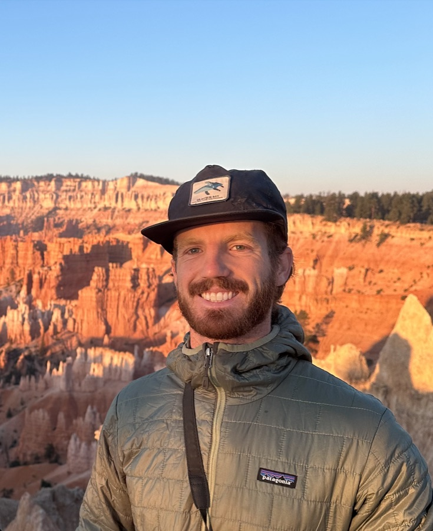

<!--
  HOME: the whole site in one scroll (Photography is its own page).
  Sections, top to bottom, each with an id the navbar links to:
    hero · #about · numbers · #research · #projects · #publications · #experience · #contact
  Research entries: most important first. Move whole <div class="entry"> blocks to reorder.
  Banner photo: set --hero-img in the <section class="photo-hero"> tag below.
-->

::: {.column-screen}
```{=html}
<section class="photo-hero" style="--hero-img:url('/assets/hero-sierra-flowers.jpg'); --hero-pos:center top; --hero-sky:#92B8F0; --hero-name-gap:clamp(1rem, 4vh, 2.5rem);">
  <div class="photo-hero-inner">
    <div class="photo-hero-name" role="heading" aria-level="1">Jackson Coldiron</div>
    <p class="photo-hero-tag">Environmental Scientist · Water · Land · Remote Sensing</p>
  </div>
  <a class="scroll-cue" href="#about" aria-label="Scroll to About"><i class="bi bi-chevron-down"></i></a>
</section>
```
:::

::: {.column-screen}
```{=html}
<div class="wrap">

<!-- ABOUT -->
<section class="section" id="about">
  <div class="about-grid">
    <div>
      <div class="eyebrow">About</div>
      <h2 class="section-title">Data science for water, food, and the landscapes in between</h2>
      <p class="lead-text">
        My work sits at the intersection of <strong>water resources</strong>,
        <strong>climate-smart agriculture</strong>, and <strong>conservation planning</strong>.
        I map irrigation from space, model where multifunctional landscapes like agroforestry
        and agrivoltaics can work, and translate groundwater science into policy.
      </p>
      <p>
        I hold a Master of Environmental Science &amp; Management from UC Santa Barbara's
        <a href="https://bren.ucsb.edu">Bren School</a> (Water Resource Management, 4.00 GPA).
        I'm currently a Groundwater Policy Intern at the
        <a href="https://www.edf.org">Environmental Defense Fund</a>, where I lead a landscape
        analysis for California DWR's Groundwater Accounting project. Before that I was an
        Arnhold Graduate Fellow with Conservation International and the Larsen Lab, and a
        research assistant in UCSB's Water, Vegetation &amp; Society Lab, where I mapped
        smallholder irrigation across Zambia.
      </p>
      <p>
        Before Bren I worked on sustainability partnerships in New York, farmed in Colombia,
        worked with California native plants at a nursery in Oakland, and tracked kiwi chicks by radio telemetry
        in New Zealand. I bring that field-level curiosity to every dataset.
      </p>
    </div>
    <div class="about-side">
      
    <dl class="facts">
      <dt>Currently</dt>
      <dd>Groundwater Policy Intern, Environmental Defense Fund</dd>
      <dt>Education</dt>
      <dd>MESM, UC Santa Barbara (2026)<br>BBA, University of Wisconsin–Madison (2021)</dd>
      <dt>Based in</dt>
      <dd>Santa Barbara, California</dd>
      <dt>Toolkit</dt>
      <dd>R · Python · Google Earth Engine · ArcGIS Pro · HPC/SLURM · Shiny · Quarto</dd>
      <dt>Languages</dt>
      <dd>English · Spanish (professional)</dd>
    </dl>
    </div>
  </div>
</section>


<!-- BY THE NUMBERS -->
<section class="band">
  <div class="eyebrow">By the numbers</div>
  <h2 class="section-title" style="margin-bottom:.5rem">Research at scale</h2>
  <div class="stats">
    <div class="stat"><div class="stat-num">400 km²</div><div class="stat-label">of previously unrecorded smallholder irrigation identified in Zambia</div></div>
    <div class="stat"><div class="stat-num">50M+</div><div class="stat-label">Sentinel-2 images pulled through an HPC pipeline across 188K locations</div></div>
    <div class="stat"><div class="stat-num">434K</div><div class="stat-label">pixel-months analyzed to test irrigation as a drought buffer (2015–2024)</div></div>
    <div class="stat"><div class="stat-num">690+</div><div class="stat-label">quote-verified groundwater findings coded from 20,000+ pages of plans</div></div>
  </div>
</section>


<!-- RESEARCH -->
<section class="section" id="research">
  <div class="eyebrow">Research</div>
  <h2 class="section-title">Water, food, and land</h2>
  <p class="theme-intro">My research asks how water, food, and land systems are changing and what managers can do about it.
  I combine satellite remote sensing, geospatial modeling, and policy analysis, and I work closely with the agencies, NGOs,
  and communities who use the results.</p>
<div class="entry" id="groundwater">
  <div class="entry-when">Jun 2026 – present</div>
  <div>
    <h3>Groundwater Accounting Landscape Analysis</h3>
    <div class="role">Groundwater Policy Intern · Environmental Defense Fund · funded by California DWR</div>
    <p>Leading a policy and literature landscape analysis to inform a statewide Groundwater Accounting Platform.
    I synthesized 65 peer-reviewed papers and 65+ groundwater plans, rules, and reports (20,000+ pages) from six
    subbasins, coding 690+ quote-verified findings on stream depletion, multi-benefit land repurposing, and
    community equity that inform best-practice recommendations to DWR.</p>
    <div class="tags"><span class="tag water">SGMA</span><span class="tag water">Groundwater</span><span class="tag">Policy analysis</span><span class="tag">Python</span></div>
    <div class="links"><a href="https://jacksoncoldiron.github.io/groundwater-accounting-portfolio/"><i class="bi bi-window"></i> Interactive portfolio site</a></div>
  </div>
</div>

<div class="entry" id="landscapes">
  <div class="entry-when">Oct 2025 – Sep 2026</div>
  <div>
    <h3>Agroforestry &amp; Agrivoltaic Suitability Across Sub-Saharan Africa (SPARCLE)</h3>
    <div class="role">Arnhold Graduate Fellow · Larsen Lab (UCSB) &amp; Conservation International</div>
    <p>Built continental-scale R geospatial pipelines that harmonize 10+ climate, soil, land-cover, and
    socioeconomic layers at 1 km to map suitability for agroforestry and agrivoltaic systems under current
    conditions and two climate scenarios (SSP1-2.6, SSP3-7.0). Quantified crop-yield co-benefits under shading and
    electricity-generation potential. Led a submission-ready manuscript for <em>Environmental Research Letters</em>
    with faculty advisors and Conservation International.</p>
    <div class="tags"><span class="tag land">Agroforestry</span><span class="tag sand">Agrivoltaics</span><span class="tag">Multi-criteria analysis</span><span class="tag">R · terra</span><span class="tag">CHELSA</span></div>
    <div class="links"><span class="muted"><i class="bi bi-lock"></i> Repository private until publication</span></div>
  </div>
</div>

<div class="entry" id="irrigation">
  <div class="entry-when">Aug 2025 – present</div>
  <div>
    <h3>Does Irrigation Buffer Crops Against Drought?</h3>
    <div class="role">Independent research · UCSB Geography · advisor: Zoe Pierrat</div>
    <p>Isolating the human contribution to evapotranspiration by comparing OpenET satellite-derived ET with NLDAS
    modeled ET across Western U.S. croplands, to estimate consumptive water use and aquifer drawdown. Using
    solar-induced chlorophyll fluorescence (SIF) across 434,000+ pixel-months (2015–2024), I find that irrigation
    buffers crop photosynthesis under moderate drought, with 83.7% of irrigated pixels showing a positive
    buffering signal, but loses effectiveness under severe drought.</p>
    <div class="tags"><span class="tag water">Evapotranspiration</span><span class="tag">SIF</span><span class="tag">OpenET</span><span class="tag">Python · xarray</span></div>
    <div class="links"><a href="https://github.com/jacksoncoldiron/SIF-Analysis"><i class="bi bi-github"></i> SIF analysis code</a></div>
  </div>
</div>

<div class="entry" id="zambia">
  <div class="entry-when">Nov 2024 – Aug 2026</div>
  <div>
    <h3>Mapping Dry-Season Smallholder Irrigation in Zambia</h3>
    <div class="role">Graduate Research Assistant · Water, Vegetation &amp; Society (WAVES) Lab, UCSB · with Anna Boser &amp; Kelly Caylor</div>
    <ul>
      <li>Designed a satellite image labeling protocol and led 4 undergraduates to label 2,325 images at 933 locations,
      building a benchmark ML dataset. Irrigation appeared at 27% of sites, about 400 km² with no prior record.</li>
      <li>Engineered an HPC pipeline (SLURM, Earth Engine, Python) that has downloaded 1.4M+ Sentinel-2 time-series
      stacks (50M+ images) for 188K locations over 10 years, with job recovery and QA checks.</li>
      <li>Spent summer 2025 in Lusaka with the University of Zambia. I built an R Shiny data explorer for local
      stakeholders, gave three seminars, and held ten meetings with researchers, NGOs, and government officials.</li>
    </ul>
    <div class="tags"><span class="tag water">Irrigation</span><span class="tag">Sentinel-2</span><span class="tag">Machine learning</span><span class="tag">HPC</span><span class="tag">Shiny</span></div>
    <div class="links"><a href="#zambia-explorer"><i class="bi bi-window"></i> About the Shiny explorer</a><span class="muted"><i class="bi bi-lock"></i> Code in a private lab repository</span></div>
  </div>
</div>

<div class="entry" id="redshanks">
  <div class="entry-when">Dec 2024 – Jun 2025</div>
  <div>
    <h3>Fuel-Reduction Impacts &amp; Redshanks Habitat</h3>
    <div class="role">Conservation Intern · Los Padres ForestWatch</div>
    <p>GIS habitat and vegetation analyses evaluating the ecological impacts of proposed U.S. Forest Service
    fuel-reduction projects, producing spatial layers to support conservation-focused alternatives, plus a
    distribution analysis of <em>Adenostoma sparsifolium</em> (Redshanks) for climate adaptation planning.</p>
    <div class="tags"><span class="tag land">Chaparral</span><span class="tag">ArcGIS Pro</span><span class="tag">R</span></div>
    <div class="links"><a href="https://github.com/jacksoncoldiron/LPFW_RiskReduction_GIS"><i class="bi bi-github"></i> GIS processing code</a></div>
  </div>
</div>

</section>

<!-- PROJECTS -->
<section class="section" id="projects">
  <div class="eyebrow">Projects</div>
  <h2 class="section-title">Applied projects &amp; apps</h2>
  <div class="card-grid two" style="margin-top:.5rem">

  <div class="jc-card lift" id="amazonia">
    <div class="card-meta">Master's group project · Conservation International · 2025–26</div>
    <h3>Assessing the Climate Change Exposures to Indigenous Peoples and Local Communities in Amazonia</h3>
    <p>As Data Manager, partnered with Conservation International's Global IPLC Center to assess how climate risks
    intersect with Indigenous Peoples' and Local Communities' territories across Amazonia, and what that means for
    irrecoverable carbon and biodiversity. Built ArcGIS Pro and R models to identify territories suited to
    conservation and restoration based on land use, land-cover transitions, and ecological climate-buffering
    properties, within a rights-based framework aimed at 30×30 and COP30 in Belém. Faculty advisor: Bruce Kendall.</p>
    <div class="tags"><span class="tag land">Amazonia</span><span class="tag dune">Climate justice</span><span class="tag">ArcGIS Pro</span><span class="tag">R · prioritizr</span></div>
    <div class="card-links"><span class="private"><i class="bi bi-lock"></i> Group repository (private)</span></div>
  </div>

  <div class="jc-card lift" id="merced">
    <div class="card-meta">Watershed analysis · Bren School · 2026</div>
    <h3>Merced River Watershed Analysis</h3>
    <p>An integrated characterization of the 3,300 km² Merced River system, covering flow regime alteration, sediment
    transport, and lower-reach channel geomorphology. Flow-duration and flood-frequency curves show an 80% reduction in
    mean annual flood from dam operations and permanent sediment immobility in the lower reach.</p>
    <div class="tags"><span class="tag water">Hydrology</span><span class="tag water">Geomorphology</span><span class="tag">R</span></div>
  </div>

  <div class="jc-card lift" id="zambia-explorer">
    <div class="card-meta">R Shiny app · Zambia · 2025</div>
    <h3>Zambia Smallholder Irrigation Explorer</h3>
    <p>A data explorer built for Zambian researchers, NGOs, and government partners to browse where dry-season
    smallholder irrigation was detected across the country, from 2,325 labeled satellite images at 933 sites. I
    built it during a summer with the University of Zambia in Lusaka and shaped it through ten stakeholder meetings.</p>
    <div class="tags"><span class="tag water">Irrigation</span><span class="tag">Shiny</span><span class="tag">leaflet</span><span class="tag">sf</span></div>
    <div class="card-links">
      <!-- EDIT: add the deployed app URL here when available -->
      <a href="#zambia"><i class="bi bi-arrow-right"></i> The research behind it</a>
      <span class="private"><i class="bi bi-lock"></i> Lab repository (private)</span>
    </div>
  </div>

  <div class="jc-card lift" id="dunes">
    <div class="card-meta">Policy analysis · UCSB Geography · 2025</div>
    <h3>Coastal Dune Restoration in Sea-Level Rise Planning</h3>
    <p>A systematic content analysis of 55 California sea-level rise adaptation plans, each coded into a 27-variable
    dataset. About 95% of jurisdictions mention dunes, but most engage only at a low level, and native planting is
    proposed nearly 4× as often as invasive removal. I developed a "recognition–action gap" framework from the
    findings and paired it with mapping of historic dune extent, NOAA inundation projections, and CalEnviroScreen to
    prioritize restoration that protects disadvantaged communities.</p>
    <div class="tags"><span class="tag dune">Coastal adaptation</span><span class="tag dune">Nature-based solutions</span><span class="tag">ArcGIS</span></div>
  </div>

  <div class="jc-card lift" id="salinas">
    <div class="card-meta">Groundwater management · Bren School · 2025</div>
    <h3>Salinas River Watershed: Sustainable Water Management Plan</h3>
    <p>Synthesized climate, hydrologic, land-use, population, and water-use data into a management plan for the Salinas
    River Watershed. Recommendations integrate recharge enhancement, irrigation-efficiency analysis, and
    land-use-specific BMPs to reduce overdraft and support SGMA compliance.</p>
    <div class="tags"><span class="tag water">SGMA</span><span class="tag">ArcGIS Pro</span><span class="tag">R</span></div>
    <div class="card-links"><a href="media/salinas_watershed_plan.pdf"><i class="bi bi-file-earmark-pdf"></i> Read the plan (PDF)</a></div>
  </div>

  <div class="jc-card lift" id="intercropping">
    <div class="card-meta">R Shiny app · Bren School · 2025</div>
    <h3>Global Intercropping Meta-Analysis Explorer</h3>
    <p>An interactive R Shiny app for a global meta-analysis of intercropping experiments, with map, time-series, and
    crop-pair views, plus a PCA on land-equivalent-ratio metrics to find what drives yield gains and input reductions.</p>
    <div class="tags"><span class="tag land">Agroecology</span><span class="tag">Shiny</span><span class="tag">PCA</span></div>
    <div class="card-links">
      <a href="https://github.com/jacksoncoldiron/shiny_intercropping_jc_nd_ig"><i class="bi bi-github"></i> Code</a>
      <!-- EDIT: add <a href="https://...shinyapps.io/...">Live app</a> if deployed -->
    </div>
  </div>

</div>


  <h3 class="subhead" id="course-projects">Course projects</h3>
  <div class="card-grid">

  <div class="jc-card">
    <div class="card-meta">Literature review &amp; interviews · 2024</div>
    <h3>SGMA, Biodiversity &amp; Land Repurposing</h3>
    <p>Seven expert interviews and a literature review on how SGMA-driven fallowing affects biodiversity, and on
    incentives for multi-benefit land repurposing in the Central Valley.</p>
    <div class="tags"><span class="tag water">SGMA</span><span class="tag land">Land repurposing</span></div>
  </div>

  <a class="jc-card" href="https://github.com/jacksoncoldiron/aquaculture-suitability-analysis">
    <div class="card-meta">R · Marine spatial planning</div>
    <h3>West Coast Aquaculture Suitability</h3>
    <p>Which West Coast EEZs suit Pacific oysters and giant kelp, based on sea-surface temperature and depth,
    with a San Francisco Bay case study.</p>
    <div class="tags"><span class="tag water">Ocean</span><span class="tag">terra</span></div>
  </a>

  <a class="jc-card" href="https://github.com/jacksoncoldiron/Texas-WinterStorm-Blackout-Analysis">
    <div class="card-meta">R · Night lights</div>
    <h3>Texas Winter Storm Blackouts</h3>
    <p>VIIRS night lights, OpenStreetMap, and census data to find which Houston homes lost power in the February
    2021 storm and whether outages fell harder on lower-income areas.</p>
    <div class="tags"><span class="tag">VIIRS</span><span class="tag">sf · stars</span></div>
  </a>

  <a class="jc-card" href="https://github.com/jacksoncoldiron/Redlining-EJ-LosAngeles">
    <div class="card-meta">R · Environmental justice</div>
    <h3>Redlining &amp; Environmental Justice in LA</h3>
    <p>How 1930s HOLC redlining grades track today's PM2.5, income, and life-expectancy burdens, and how they bias
    where citizen scientists record birds.</p>
    <div class="tags"><span class="tag dune">EJ</span><span class="tag">tmap</span></div>
  </a>

  <a class="jc-card" href="https://github.com/jacksoncoldiron/ESM232_AlmondModel">
    <div class="card-meta">R · Environmental modeling</div>
    <h3>Almond Yield &amp; Climate</h3>
    <p>A reproducible, function-based R model of almond yield anomalies as a function of temperature and
    precipitation drivers.</p>
    <div class="tags"><span class="tag land">Agriculture</span><span class="tag">Modeling</span></div>
  </a>

</div>


  <p class="muted" style="margin-top:1.5rem">More on <a href="https://github.com/jacksoncoldiron">GitHub <i class="bi bi-arrow-up-right"></i></a></p>
</section>

<!-- PUBLICATIONS -->
<section class="section" id="publications">
  <div class="eyebrow">Outputs</div>
  <h2 class="section-title">Publications, reports &amp; talks</h2>
  <h3 style="font-size:1.1rem;margin-top:1.2rem">Manuscripts</h3>
<!-- EDIT: replace with full citations (authors, title, journal, DOI) as they're submitted/accepted -->
<ul class="pubs">
  <li><span class="status">In preparation</span><br>
    <strong>Coldiron, J.</strong>, et al. Suitability of agroforestry and agrivoltaic systems across Sub-Saharan
    Africa under current and future climate. Target journal: <em>Environmental Research Letters</em>.</li>
  <li><span class="status">In preparation</span><br>
    <strong>Coldiron, J.</strong>, et al. Irrigation as a buffer for crop photosynthesis under drought in Western
    U.S. croplands. Target journal: <em>Irrigation Science</em>.</li>
</ul>

<h3 style="font-size:1.1rem;margin-top:1.6rem">Reports &amp; interactive products</h3>
<ul class="pubs">
  <li><strong>Accounting for Groundwater: from measurement to management under SGMA</strong> (2026). Interactive
    portfolio site adapted from a landscape analysis for California DWR's Groundwater Accounting project.
    <a href="https://jacksoncoldiron.github.io/groundwater-accounting-portfolio/">View site</a></li>
  <li><strong>Salinas River Watershed Sustainable Water Management Plan</strong> (2025). Bren School.
    <a href="media/salinas_watershed_plan.pdf">PDF</a></li>
</ul>

<h3 style="font-size:1.1rem;margin-top:1.6rem">Presentations</h3>
<ul class="pubs">
  <li><strong>Dry-season irrigation mapping for smallholders in Zambia.</strong> Three seminars for university
    and agency audiences, University of Zambia, Lusaka (2025).</li>
  <li><strong>The recognition–action gap: dune restoration in California sea-level rise planning.</strong>
    Conference presentation (2025).</li>
  <li><strong>Irrigation labeling protocol and inter-rater reliability.</strong> UCSB WAVES Lab (2025).</li>
  <li><strong>SGMA: biodiversity, fallowing &amp; land repurposing.</strong> Bren School graduate seminar
    and expert panel (2024).</li>
</ul>

</section>

<!-- EXPERIENCE: roles only (projects are described above, so no repeats here) -->
<section class="section" id="experience">
  <div class="eyebrow">Experience</div>
  <h2 class="section-title">Where I've worked &amp; studied</h2>
  <div class="about-grid">
    <div>
      <ul class="roles">
        <li><span class="when">2026 – now</span><div><strong>Groundwater Policy Intern</strong><span>Environmental Defense Fund</span></div></li>
        <li><span class="when">2025 – 26</span><div><strong>Arnhold Graduate Fellow</strong><span>Larsen Lab, UCSB &amp; Conservation International</span></div></li>
        <li><span class="when">2024 – 26</span><div><strong>Graduate Research Assistant</strong><span>Water, Vegetation &amp; Society Lab, UCSB</span></div></li>
        <li><span class="when">2025 – 26</span><div><strong>Data Manager, Master's Group Project</strong><span>Conservation International, Global IPLC Center</span></div></li>
        <li><span class="when">2025</span><div><strong>Climate-Smart Agriculture Research Intern</strong><span>University of Zambia, Lusaka</span></div></li>
        <li><span class="when">2024 – 25</span><div><strong>Conservation Intern</strong><span>Los Padres ForestWatch</span></div></li>
        <li><span class="when">2025 – now</span><div><strong>Field Volunteer Researcher</strong><span>WAVES Lab · Dangermond Preserve (Coast Live Oak drought physiology)</span></div></li>
        <li><span class="when">2024</span><div><strong>Kiwi Conservation Volunteer</strong><span>Whakatāne Kiwi Project, New Zealand</span></div></li>
        <li><span class="when">2024</span><div><strong>Plant Specialist</strong><span>Broadway Terrace Nursery, Oakland</span></div></li>
        <li><span class="when">2023</span><div><strong>Farmer (WWOOF)</strong><span>Colombia</span></div></li>
        <li><span class="when">2021 – 23</span><div><strong>Environmental &amp; Social Impact Partnerships</strong><span>The Vita Coco Company, New York</span></div></li>
        <li><span class="when">2022</span><div><strong>Climate Fellow · Science Communications Intern</strong><span>Climatebase · High Atlas Foundation</span></div></li>
      </ul>
      <h3 class="subhead">Education</h3>
      <ul class="roles">
        <li><span class="when">2026</span><div><strong>Master of Environmental Science &amp; Management</strong><span>Bren School, UC Santa Barbara · Water Resource Management · 4.00 GPA</span></div></li>
        <li><span class="when">2021</span><div><strong>BBA, Finance &amp; Urban Land Economics</strong><span>University of Wisconsin–Madison · 3.67 GPA</span></div></li>
      </ul>
      <p style="margin-top:1.4rem">
        <!-- <a class="btn-pill dark" href="media/Coldiron_CV.pdf"><i class="bi bi-download"></i> Download CV (PDF)</a> -->
        <a class="btn-pill ghost" href="mailto:jcoldiron@bren.ucsb.edu"><i class="bi bi-envelope"></i> Request full CV</a>
      </p>
    </div>
    <div class="skill-grid" style="grid-template-columns:1fr">
      <div><h4>Geospatial &amp; remote sensing</h4><p>Google Earth Engine · ArcGIS Pro (ModelBuilder, Spatial Analyst, arcpy) · QGIS · Sentinel-2, Landsat, ECOSTRESS, OpenET, NLDAS, OCO-2 SIF</p></div>
      <div><h4>R &amp; Python</h4><p>sf · terra · stars · tmap · leaflet · shiny · tidyverse · prioritizr · geopandas · xarray · rasterio · scikit-learn</p></div>
      <div><h4>Computing</h4><p>HPC / SLURM · Git &amp; GitHub · Quarto · reproducible pipelines</p></div>
      <div><h4>Policy &amp; communication</h4><p>SGMA · NEPA/CEQA · water policy · content analysis · stakeholder engagement</p></div>
      <div><h4>Leadership</h4><p>Bren-ES Fellows Mentor · Bren Seminar Committee · Graduate Mentor, The Wildlife Society · WAVES Lab team lead</p></div>
      <div><h4>Certifications</h4><p>NASA ARSET (Animal Tracking &amp; Remote Sensing) · Data Science with Python · Data Analyst in R · ArcGIS Online</p></div>
      <div><h4>Languages</h4><p>English (native) · Spanish (professional working proficiency)</p></div>
    </div>
  </div>
</section>

<!-- CONTACT -->
<section class="section contact" id="contact">
  <div class="band" style="text-align:center">
    <div class="eyebrow">Contact</div>
    <h2 class="section-title">Let's talk water, land, and data</h2>
    <p class="muted" style="max-width:36rem;margin:0 auto 1.4rem">I'm always glad to connect about research, collaborations, and roles in water
    resources, agriculture, and conservation.</p>
    <a class="btn-pill dark" href="mailto:jcoldiron@bren.ucsb.edu"><i class="bi bi-envelope"></i> Email me</a>
    <a class="btn-pill ghost" href="https://www.linkedin.com/in/jackson-coldiron/"><i class="bi bi-linkedin"></i> LinkedIn</a>
    <a class="btn-pill ghost" href="https://github.com/jacksoncoldiron"><i class="bi bi-github"></i> GitHub</a>
  </div>
</section>

</div>
```
:::
